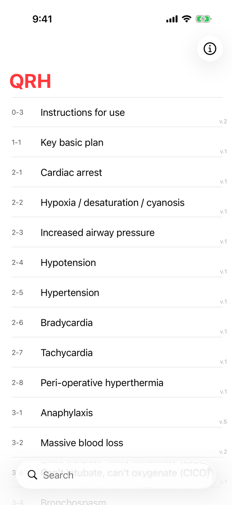
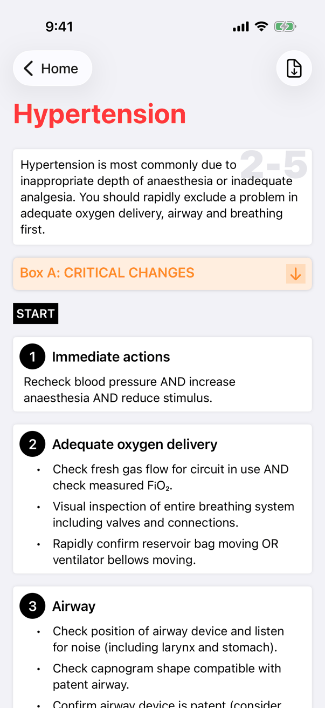
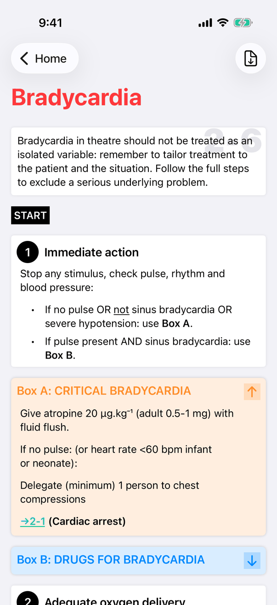
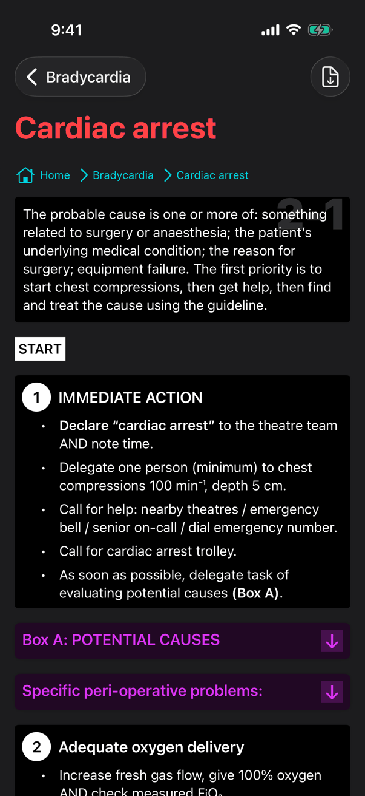
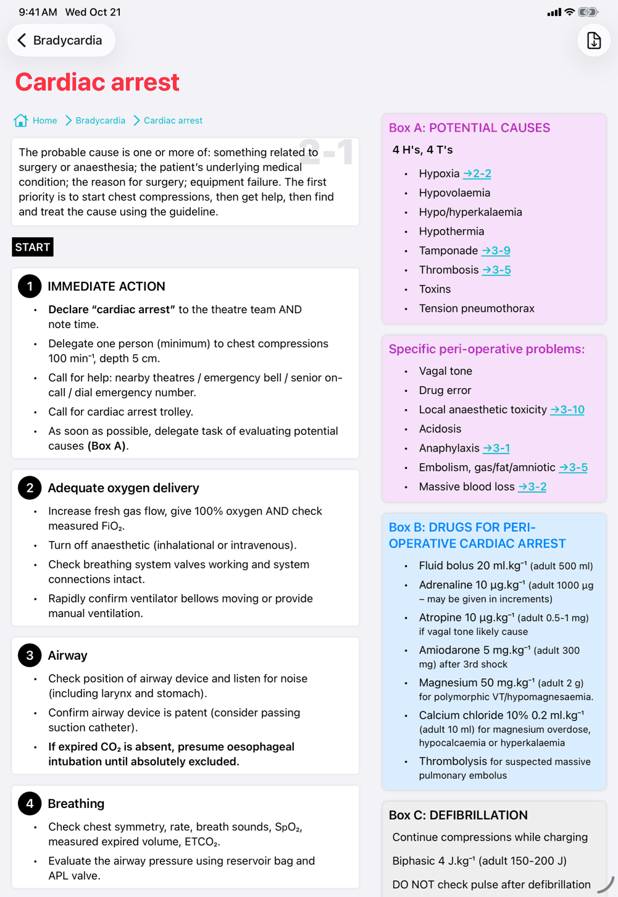
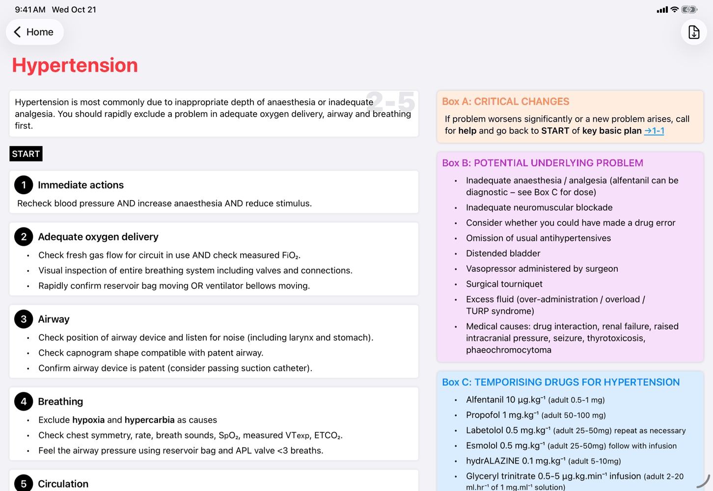

# Quick Reference Handbook (QRH)

## Screenshots

### iPhone
 |  |  | 

### iPad

 | 

## Features
- Unofficial derivative of the Association of Anaesthetists Quick Reference Handbook (QRH): www.anaesthetists.org/Quick-Reference-Handbook (CC BY-NC-SA 4.0)
- iOS port of <a href="http://github.com/anaes-dev/qrh-android">github.com/anaes-dev/qrh-android</a>
- ***Not endorsed by the Association of Anaesthetists***
- Rapidly searchable guideline list
- Simple guideline layout echoing original handbook
- Clickable links between guidelines
- Compatible with iOS dark mode
- Large format two-column layout for iPad
- Easily updatable through modification of JSON assets
- [![CC BY-NC-SA 4.0][cc-by-nc-sa-shield]][cc-by-nc-sa] Released under same Creative Commons license as original work  

[Privacy policy](PRIVACY.md)

This application has been neither professionally developed nor tested. It carries no certification markings, regulatory approvals or technical assessment appraisals. Please read full guidance and disclaimers on first launch.

## License
This work is licensed under a [Creative Commons Attribution-NonCommercial-ShareAlike 4.0
International License][cc-by-nc-sa].

[![CC BY-NC-SA 4.0][cc-by-nc-sa-image]][cc-by-nc-sa]

[cc-by-nc-sa]: http://creativecommons.org/licenses/by-nc-sa/4.0/
[cc-by-nc-sa-image]: https://licensebuttons.net/l/by-nc-sa/4.0/88x31.png
[cc-by-nc-sa-shield]: https://img.shields.io/badge/License-CC%20BY--NC%20SA%204.0-lightgrey.svg
You may distribute original version or adapt for yourself and distribute with acknowledgement of source. 
You may not use for commercial purposes.  

## Download

Available on the App Store:

## Technical
*(For any updates, modifications or derivatives)*

All guidelines are stored in a single file, '/data.json', shared with the Android app.

Each guideline has 'code', 'title', 'version', 'url', 'copyright' and 'content' keys.

Each 'content' array contains 'type', 'head', 'body' and 'step' keys, and optionally 'branch'.

These populate different styled cards for each guideline page.

The version line, disclaimer and licence footer at the end of each guideline are added by the app. The licence footer names the guideline's publisher and year from its 'copyright' key ('holder' refers to an entry in 'copyrightHolders').

### Card views

Type integer value determines the appearance of the generated card:
1. Introductory text (body only)
2. START text (body only)
3. Guideline step with bold heading and separate content (head, body and step)
4. Guideline step with single text field (body and step)
5. Orange expanding box (head and body)
6. Blue expanding box (head and body)
7. Green expanding box (head and body)
8. Black expanding box (head and body)
9. Purple expanding box (head and body)
10. Image (caption in head, image name in body)
11. Version text (body only; added by the app)
12. Red disclaimer card (head only; added by the app)  
13. Branch condition, e.g. "If circulatory arrest:" (body and branch)

#### Branches
Where a guideline splits into alternative paths that share step numbers (3-7, 3-10), each path starts with a type 13 card, and that card and every card in the path have the same 'branch' id (e.g. "arrest" and "no-arrest"). Cards outside a branch have no 'branch' key. A run of consecutive branches is shown as one fork: side by side when there's room (600 pt), otherwise stacked, each with its condition as a heading and a rail beside its cards. A branch ends at the next type 13 card or the first card with a different 'branch'.

On iPad, a box repeated in every branch (identical apart from 'branch') appears once in the side column.

### Card contents

Basic HTML tags (B, U, I, LI) can be used within for formatting where required. All tags should be closed, otherwise may lead to parsing errors. 

Unicode subscript and superscript characters are used rather than SUB and SUP spans due to line-height issues on earlier Android versions.

#### Guideline links
Generated when the following regex is matched:  
`[(]?[→][\s]?[1-4][-][0-9]{1,2}[)]?`  
Therefore can have with or without parentheses, and is insensitive to space between → and guideline code.

#### Phone links
Automatic link detection using NSDataDetector.

#### Web links
Automatic link detection using NSDataDetector.

*iOS, iPhone, iPad and App Store are trademarks of Apple Inc.*
